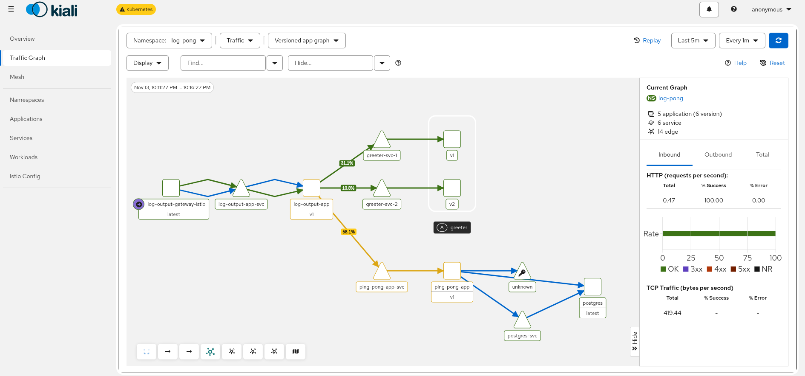

# Log output in the service mesh (Exercise 5.3)

The Log output and Ping-pong applications running in the Istio ambient mesh on the local k3d cluster, extended with a new [greeter](../greeter-app) service. Log output calls the greeter and shows its greeting. Two greeter versions run side by side, and the traffic between them is split 75% / 25%.

The cluster and Istio setup is described in [istio-bookinfo](../istio-bookinfo/README.md#cluster-and-istio-setup) (exercise 5.2).

## Architecture

```
browser ── localhost:9080 ── log-output-gateway (Istio ingress)
                               ├── /          → log-output-app-svc ── log-output-app (writer + reader)
                               └── /pingpong  → ping-pong-app-svc  ── ping-pong-app ── postgres

log-output-app ── greeter-svc ──(waypoint, HTTPRoute 75/25)──┬── greeter-svc-1 ── greeter-v1 "Hello"
                                                             └── greeter-svc-2 ── greeter-v2 "Moi"
```

- [namespace.yaml](namespace.yaml): namespace `log-pong` with the labels `istio.io/dataplane-mode=ambient` (all pods join the mesh) and `istio.io/use-waypoint=waypoint` (service traffic goes through the waypoint proxy).
- [waypoint.yaml](waypoint.yaml): the waypoint proxy that handles L7 routing in ambient mode.
- [gateway.yaml](gateway.yaml) and [route.yaml](route.yaml): Istio ingress gateway; `/pingpong` is rewritten to `/` for the Ping-pong app.
- [greeter.yaml](greeter.yaml): deployments `greeter-v1` and `greeter-v2` (same image, different `GREETING` and `version` label), and three services. `greeter-svc` is the one Log output calls, while `greeter-svc-1` and `greeter-svc-2` select a single version each.
- [greeter-route.yaml](greeter-route.yaml): HTTPRoute with `greeter-svc` as its parent. It sends 75% of requests to `greeter-svc-1` and 25% to `greeter-svc-2`.
- [log-output.yaml](log-output.yaml), [ping-pong.yaml](ping-pong.yaml), [postgres.yaml](postgres.yaml): the existing applications, adapted for k3d (Istio gateway instead of GKE, `local-path` storage class).

Log output gets the greeter address from the `GREETER_SERVICE` environment variable. Without it, the app works as before, so the GKE setup in [log-output-app](../log-output-app) is unchanged.

## Deploy

Build the changed log reader and the greeter, and load them into the cluster:

```bash
docker build -t zanaad/log-reader-app:5.3 log-output-app/log-reader-app
docker build -t zanaad/greeter-app:1.0 greeter-app
k3d image import zanaad/log-reader-app:5.3 zanaad/greeter-app:1.0 -c mesh
```

Create the namespace and the database secret (the secret is not stored in git), then apply everything:

```bash
cd log-output-mesh
kubectl apply -f namespace.yaml
kubectl create secret generic postgres-secret -n log-pong \
  --from-literal=POSTGRES_USER=postgres \
  --from-literal=POSTGRES_PASSWORD=<password> \
  --from-literal=POSTGRES_DB=logpong
kubectl apply -k .
kubectl get pods -n log-pong
```

## Test

```
$ curl localhost:9080/
file content: this text is from file
env variable: MESSAGE=hello world
2026-11-13T21:13:06.879Z: 893b8bb7-2dda-4cb3-91e1-3393146669c2
Ping / Pongs: 1
Greetings: Hello from greeter v1

$ curl localhost:9080/pingpong
pong 1
```

Counting which greeter answers:

```
$ for i in $(seq 1 200); do curl -s localhost:9080/ | grep -o "greeter v[12]"; done | sort | uniq -c
    152 greeter v1
     48 greeter v2
```

That is 76% / 24%. Without the HTTPRoute, `greeter-svc` would balance about 50/50 between the two pods.

## Kiali

```bash
istioctl dashboard kiali
```

**Traffic Graph**, namespace **log-pong**, graph type **Versioned app graph**, and in **Display** enable **Service Nodes** and **Traffic Distribution**.

The percentages on the edges are shares of all requests sent by Log output. Of those, 58.1% go to Ping-pong, 31.1% to `greeter-svc-1` and 10.8% to `greeter-svc-2`. Between the two greeters that is 74% / 26%, matching the 75/25 weights in the HTTPRoute.


